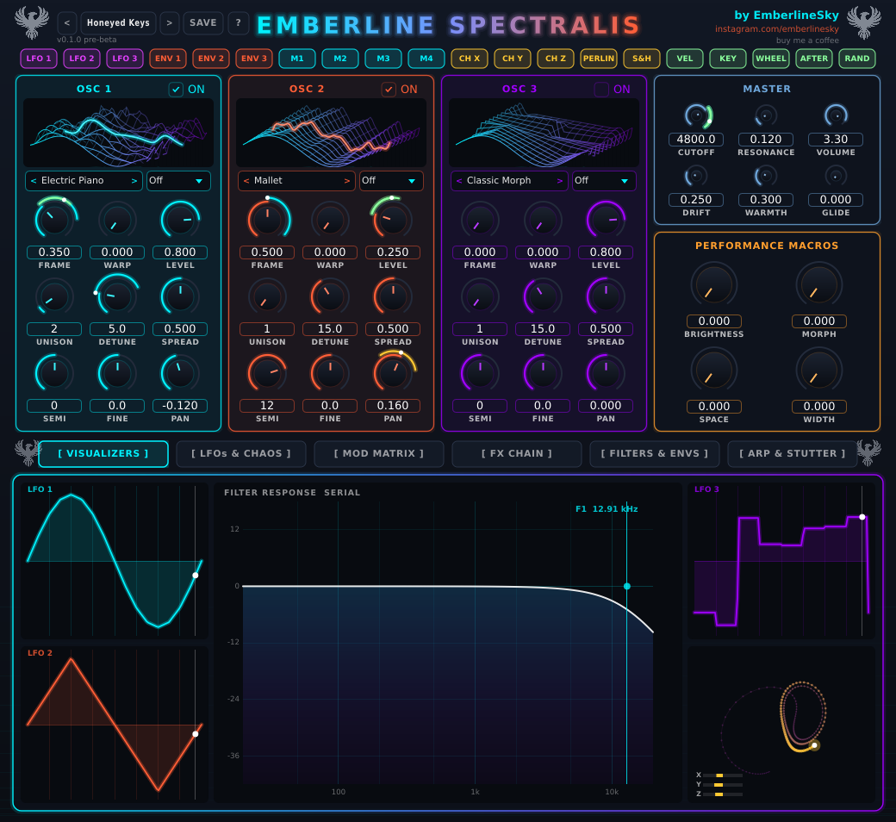

# Getting started

## Installing

**Windows:** unzip the release and copy `Emberline Spectralis.vst3` into `C:\Program Files\Common Files\VST3`.
Rescan plugins in your DAW. There's also a Standalone app (`Emberline Spectralis.exe`) you can just double-click.

**Mac:** copy `Emberline Spectralis.vst3` into `/Library/Audio/Plug-Ins/VST3` (or the same folder inside your
user Library). The beta builds aren't signed yet, so macOS may grumble the first time. Right-click the file and choose
**Open**, or if it still won't load, run this in Terminal on the plugin:
`xattr -dr com.apple.quarantine "/Library/Audio/Plug-Ins/VST3/Emberline Spectralis.vst3"`.
On Windows you might see a SmartScreen warning for the same reason: click **More info > Run anyway**.

It's a VST3 instrument, so load it on a MIDI/instrument track like any other synth.

## Your first sound

Load it up and it starts on a preset called **Honeyed Keys**. Play a few notes. Now:

1. Click the preset name at the top left and pick something from a category: Pad, Bass, Pluck, Keys...
   Use the **<** and **>** buttons to flick through them one by one.
2. Turn the **CUTOFF** knob in the Master panel. That's the filter: left is dark and muffled, right is bright.
3. Turn **M1** to **M4** in the Performance Macros box. Most presets wire these up to something fun, so they're the
   quick way to make a sound your own. The names under the knobs change from preset to preset.

That's honestly most of it. The rest of this manual is about going deeper when you want to.

## Finding your way round

The screen has three parts:

- **Top row of chips** (LFO 1, ENV 1, M1, CH X...). These are your *movers*. Drag one onto a knob and the knob starts
  moving by itself. More on that in [Moving things around](04-modulation.md).
- **The top half**: three oscillators (OSC 1-3), the Master panel and the four Macros.
- **The bottom half**: six tabs.
  - **VISUALIZERS** - the LFOs and a live picture of your filter opening and closing.
  - **LFOs & CHAOS** - draw your own LFO shapes, plus the chaos engine.
  - **MOD MATRIX** - a list of every connection.
  - **FX CHAIN** - distortion, chorus, delay, reverb.
  - **FILTERS & ENVS** - two filters, sub and noise, three envelopes.
  - **ARP & STUTTER** - the arpeggiator.

Next to the preset bar there's a **?** button: click it and choose **Open the manual** to read this in your web browser (it works
offline, the manual lives inside the plugin). The same menu has a link to buy me a coffee if you're enjoying the synth, and so does the little
"buy me a coffee" line under the artist credit. Totally optional, always appreciated.

Top right you'll see **by <artist>** and a link: that's who made the preset you're playing. Click it to visit them.
Under the preset bar there's the version number.

## Handy knob tricks

- **Drag** a knob up or down to change it.
- **Double-click** a knob to snap it back to its default.
- Click the little number box under a knob to **type** a value.
- **Right-click** a knob that has movement on it to open its modulation box (see [Moving things around](04-modulation.md)).

## Using it in your DAW

- It's a standard VST3 synth, so your DAW's automation, MIDI and presets work as usual. Your DAW remembers the sound
  in the project, so you can close and reopen without losing anything.
- The tempo-synced bits (LFOs, delay, arp) follow your DAW's tempo. In the Standalone app, there's a **TEMPO** knob in the
  Filters tab instead.
- Up to 8 notes at once.
