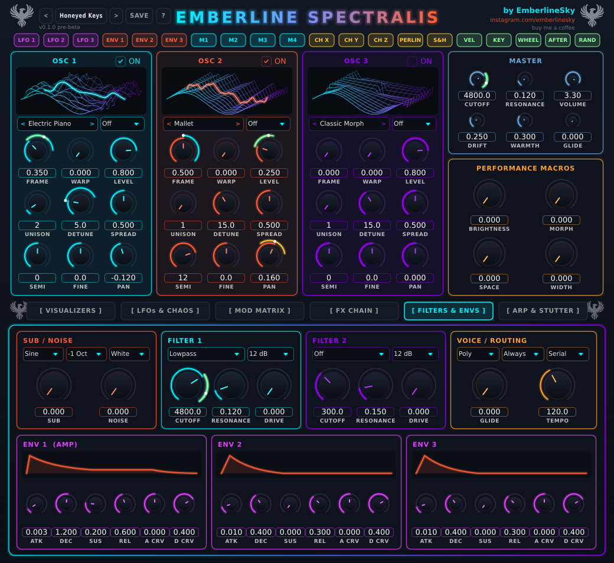

# The oscillators

An oscillator is the thing that makes the raw sound. Emberline has **three**, and each one plays a
**wavetable**: a little stack of 16 different waveforms that you can glide through.

## The knobs

Each OSC panel has the same set:

| Knob | What it does |
|---|---|
| **ON** | Turns the oscillator on or off (OSC 1 is on by default; 2 and 3 you switch on). |
| **Table** (the name box) | Which wavetable this oscillator uses. Use the arrows, or click it for a list with little pictures of each table. |
| **Warp mode** (the box next to it) | Bends the wave: Formant, Sync, Bend, Phase Dist, or Off. |
| **FRAME** | Where you are in the stack. Sweeping this is the classic "wavetable" movement. |
| **WARP** | How much of the warp mode to apply. |
| **LEVEL** | How loud this oscillator is. |
| **UNISON** | How many copies of the sound play at once (1-16). More = thicker, bigger, wider. |
| **DETUNE** | How far apart those copies are tuned. A little is warm; a lot is supersaw-y. |
| **SPREAD** | How wide they're spread across the stereo field. |
| **SEMI** / **FINE** | Tune the whole oscillator in semitones / in cents. |
| **PAN** | Pans the oscillator left or right. |

The little 3D picture at the top of each panel shows the wavetable, with a bright line for where you are right now.
It follows the oscillator it belongs to, so you can see your FRAME movement and the warp as it happens.

## Picking a wavetable

There are lots of factory tables. A few ways to think about them:

- **Classic Morph, Saw Sweep, Pulse Width...** - the "synthy" ones. Good for basses and leads.
- **Electric Piano, Grand Piano, Clavinet, Tonewheel Organ...** - real-instrument-flavoured. Great for keys and organic house.
- **Mallet, Pluck Position, Glass Harmonics, FM Bell...** - bells, plucks, glassy things.
- **Cello, Violin, Flute, Human Voice, Vowel Sweep...** - organic and vocal.
- **User 1-8** - slots for your own files, see [Your own wavetables](08-wavetables.md).

Tip: set FRAME to the middle and give it a slow LFO. Instant movement.

## Thickening things up

- Two oscillators on the same table, one tuned **+12** semitones, is a quick way to get a richer sound.
- **UNISON 4-6** with **DETUNE** around 10-20 gives you a lovely wide pad. Past 40 starts to sound chorusy and out of tune.
- Want it chunkier at the bottom? Use the **Sub** in the Filters tab (a clean sine or triangle one or two octaves down).
  The **Noise** knob (white, pink or crackle) next to it adds air and grit.

## Heads-up on CPU

Lots of unison across all three oscillators with 8 notes held is the heaviest thing the synth can do. It's still well
within what a normal computer can cope with, but if your DAW starts crackling, drop the unison first.

## Mono, legato and glide (the pitch-slide sound)

By default the synth is **polyphonic**: play a chord and every note sounds. For basses, leads and those big sliding
pitch moves you want one note at a time, and a **glide** between notes. You'll find these in the **VOICE** panel on the
FILTERS & ENVS tab, and the **GLIDE** knob is also in the Master panel.

**Voice mode**

| Mode | What it does |
|---|---|
| **Poly** | Normal: play as many notes as you like (up to 8). |
| **Mono** | One note at a time, and the newest note wins. Every new note retriggers the envelopes, so it sounds like a fresh pluck or stab. |
| **Legato** | One note at a time, but if you play a note while holding another, the sound just changes pitch without restarting. This is the smooth, singing, slidey one. |

In both mono modes, if you let go of the top note while still holding an older one, it drops back to the older note.

**Glide** (also called portamento) is how long the pitch takes to slide from one note to the next. **0** is off. A few
hundredths of a second is a subtle slur; **0.3 s** is a lovely slide; **1 s+** is a long dramatic swoop.
It always takes the same time whether you jump a tone or two octaves.

**Glide mode**

- **Always**: every note slides from the one before. In Poly mode too, each new note slides from the previous one's pitch.
- **Legato Only**: it only slides when you overlap notes (play the next one before letting go of the last). Notes you play
  separately stay tight. This is great for basslines, because the groove stays punchy and you choose when to slide.

Try this: load **Bass - Tidal Slide**, play a slow line and hold each note a bit longer than the gap. That's the slide.
Then try **Bass - Moon Drop** for a bigger one, **Lead - Sunrise Slide** for a singing lead, and **Pluck - Unalived Rat** for a
squelchy mono pluck.

Glide works with the arp too: switch the arp on, set Mono, and the arp line slurs between steps.

Note: the sustain pedal only works in Poly mode.
