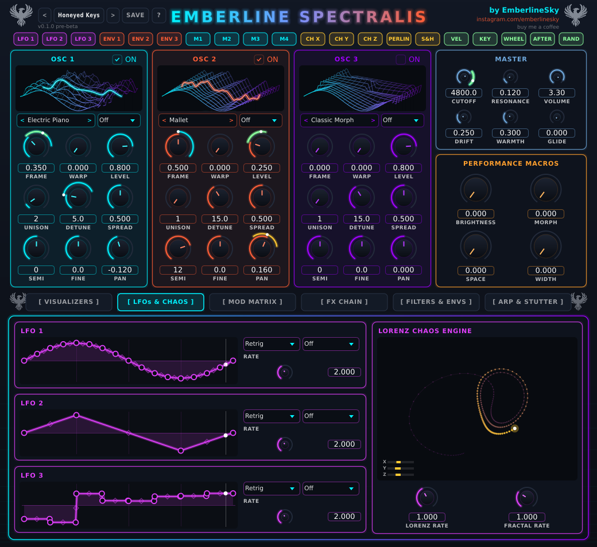
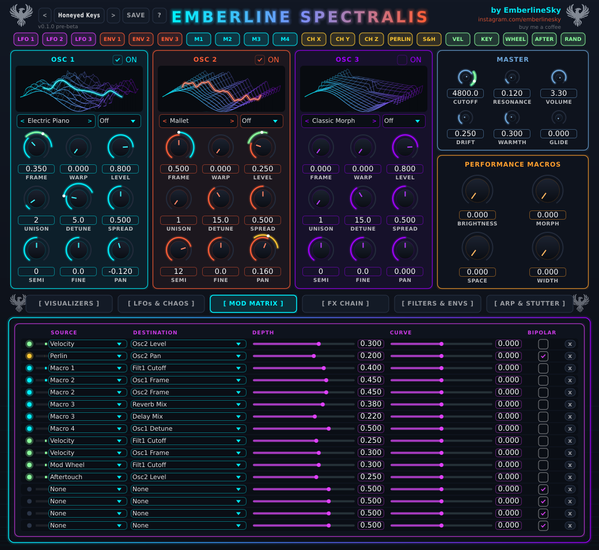

# Moving things around (modulation)

"Modulation" just means making a knob move by itself. A filter that slowly opens, a wavetable that drifts, a reverb
that swells when you push a wheel. This is what makes a patch feel alive, and it's a big part of the deep house sound.

## The movers

They're the coloured chips along the top of the screen:

| Chip | What it is |
|---|---|
| **LFO 1-3** (purple) | Slow repeating waves. Wobble, sweep, pulse. You can draw your own shapes. |
| **ENV 1-3** (red/orange) | Envelopes: shapes that play out each time you hit a note. ENV 1 is also your volume envelope. |
| **M1-M4** (cyan) | The four Macro knobs. You control these by hand (or with your DAW's automation). |
| **CH X / Y / Z** (gold) | The chaos engine: smooth, never-repeating wandering. |
| **PERLIN** (gold) | Smooth, organic random drift. |
| **S&H** (gold) | Sample-and-hold: random steps. |
| **VEL** (green) | How hard you hit the key. |
| **KEY** (green) | Which key you played (low to high). |
| **WHEEL** (green) | Your mod wheel. |
| **AFTER** (green) | Aftertouch (pressing into the key). |
| **RAND** (green) | A new random number for each note. |

## Hooking one up: drag and drop

1. **Drag a chip** from the top row.
2. **Drop it on a knob** (any knob with a little ring around it).
3. A small box pops up right there. Set **DEPTH** to how much you want it to move that knob.

That's it. You never need to leave the screen you're on.

In the box you can also:

- **CURVE** - bend how the movement feels (more at the start or more at the end).
- **BIPOLAR** - lets the mover push the knob both up and down from where it sits, instead of only one way.
- **X** (remove) - take the connection away.

To open that box again later, **right-click the knob**. If the knob has several movers on it, you'll get one row for each.

Round the knob, you'll see a coloured ring showing how far the movement reaches, and it animates live as the sound plays.

## The three LFOs

On the **LFOs & CHAOS** tab you'll find LFO 1, 2 and 3, each with a shape you can **draw**:

- **Drag the dots** to move points. **Drag the little diamond** between two points to bend that stretch of the line.
- **Double-click** the line to add a point, or double-click a point to remove it.
- **Right-click** for a menu of ready-made shapes to start from.
- **RATE** sets how fast it goes. The little box next to it ("Off" by default) lets you **sync to tempo** instead:
  pick a note length (1/4, 1/8., 1 bar, 4 bars...) and it stays locked to your DAW.
- **Retrig / Free** - Retrig restarts the shape on every note; Free just keeps running.

## The chaos engine

The Lorenz chaos engine draws a looping, never-quite-repeating path. It gives you three outputs (CH X, Y, Z).
Use it for subtle, organic movement that doesn't sound like an LFO going round and round. **LORENZ RATE** sets its speed.
**FRACTAL RATE** (right next to it) sets how fast the Perlin and S&H movers run.

## Envelopes

On the **FILTERS & ENVS** tab, three envelopes with the usual **ATK** (attack), **DEC** (decay), **SUS** (sustain),
**REL** (release), plus **A CRV** and **D CRV** to bend the attack and decay curves.

ENV 1 controls the overall volume of each note. ENV 2 and 3 are free for you to use on anything. The classic
trick: hook ENV 2 up to the filter cutoff for a pluck.

## The macros

**M1-M4** are your four performance knobs. Presets name them (Brightness, Morph, Space, Width...) and
wire them up to useful things. You can rewire them yourself by dragging the macro chips onto any knob.

## The Mod Matrix

The **MOD MATRIX** tab is a list of every connection in the preset (16 at most). Each row is
**Source -> Destination**, with depth, curve and bipolar controls. It's the same thing as dropping chips on knobs,
just in a list. It's handy for checking what's going on and for tidying things up.

## Some ideas to try

- **Slow filter breathing**: LFO 1 at about 0.2 Hz (or synced to 1 bar) -> Filter 1 Cutoff, small depth.
- **Movement in the wavetable**: LFO 2 -> OSC 1 Frame, tiny depth.
- **Pluck**: ENV 2 -> Filter 1 Cutoff, decent depth, short decay and no sustain.
- **Played harder = brighter**: Velocity -> Filter 1 Cutoff.
- **Organic wobble**: Perlin -> OSC 1 Fine or OSC 1 Pan, tiny depth.
- **One-knob drops**: Macro 1 -> Filter Cutoff, Reverb Mix and Delay Mix all at once, then automate Macro 1 in your DAW.
