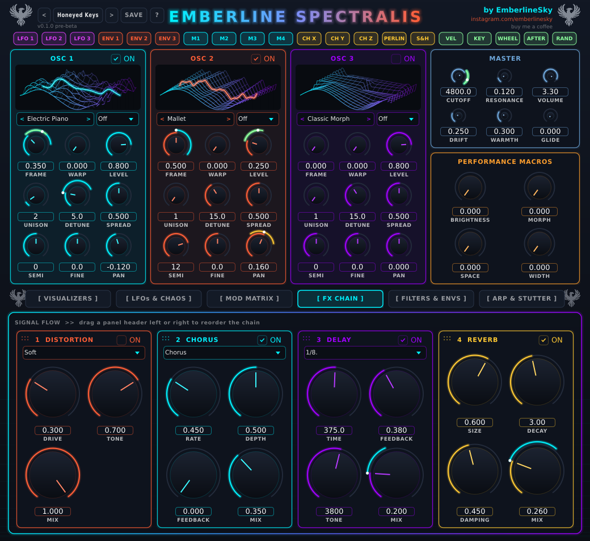

# Effects

Four effects, on the **FX CHAIN** tab: **Distortion, Chorus/Flanger, Delay and Reverb**. Each one has its own **ON**
tick box, so only the ones you use cost you any CPU.

## Changing the order

The numbers 1-4 on the panels are the running order. **Drag a panel's header left or right** to reorder them. For
example: reverb before delay gives you a washy echo; delay before reverb gives you clean echoes that sit in a room.

## Distortion

| Knob | What it does |
|---|---|
| **Type** | Soft (gentle), Hard (aggressive), Fold (wavefolding, metallic), Tube (warm). |
| **DRIVE** | How hard it's pushed. |
| **TONE** | Dark to bright. |
| **MIX** | Blend of dry and distorted. |

Tip: Tube at a low drive is a nice cheap way to warm a pad.

## Chorus / Flanger

| Knob | What it does |
|---|---|
| **Mode** | Chorus (wide and shimmery) or Flanger (jet-plane swoosh). |
| **RATE** | How fast it wobbles. |
| **DEPTH** | How much it wobbles. |
| **FEEDBACK** | Mostly for the flanger: more feedback = more metallic ring. |
| **MIX** | Blend. |

## Delay

| Knob | What it does |
|---|---|
| **Sync box** | **Off** uses the TIME knob in milliseconds. Pick a note length (1/8., 1/4, ...) and it locks to your DAW's tempo. |
| **TIME** | Delay time in ms when sync is Off. |
| **FEEDBACK** | How many repeats. High values go on for ages. |
| **TONE** | Darkens each repeat. Lower = more tape-like. |
| **MIX** | Blend. |

For melodic house, a dotted-eighth (**1/8.**) delay is the classic.

## Reverb

| Knob | What it does |
|---|---|
| **SIZE** | Room size. |
| **DECAY** | How long the tail lasts (up to 20 seconds). |
| **DAMPING** | How quickly the high end dies away in the tail. Higher = darker and smoother. |
| **MIX** | Blend. |

Tip: for pads, a big **DECAY** (4-8 s) with some **DAMPING** gives that lush, wide wash. For plucks, keep the decay short.
