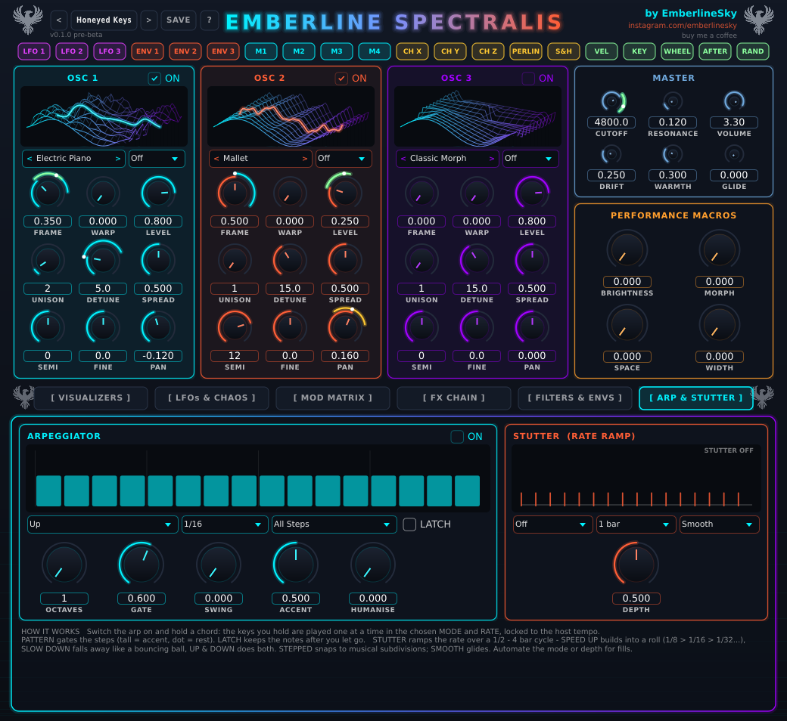

# Arp and stutter

The **ARP & STUTTER** tab has a built-in arpeggiator, with a roll-style **stutter** that speeds up and slows down.
It's off until you tick **ON**, so nothing changes in your old patches.

## The arpeggiator

Switch it on, hold a chord, and instead of playing together, the notes play one at a time. It's locked to your DAW's
tempo and transport, so it stays in time with everything else.

| Control | What it does |
|---|---|
| **ON** | Arp on/off. |
| **Mode** | The order the notes play in: Up, Down, Up/Down, Down/Up, Up/Down Repeat, Converge, Diverge, Random, As Played, or Chord (everything at once, rhythmically). |
| **Rate** | How fast: 1/32, 1/16 (default), triplets (T), dotted (.), up to 1/4. |
| **Pattern** | A rhythm over 16 steps: All Steps, Rolling, Offbeat, Syncopated, Gallop, Skip, Push, Half Time, Dotted. The bars above show which steps play, and tall bars are accents. |
| **LATCH** | Keeps playing after you let go. Play a new chord and it swaps over. Great for hands-free grooves. |
| **OCTAVES** | Stretches the pattern up 1-4 octaves. |
| **GATE** | How long each note rings: short and staccato to long and legato. |
| **SWING** | Pushes every other step late for a shuffle. |
| **ACCENT** | How much louder the accent steps are. |
| **HUMANISE** | Random little differences in velocity so it feels played, not programmed. |

Start with **Up**, **1/16**, **All Steps**, then try the patterns. **Rolling** and **Offbeat** are lovely for deep house.

## Stutter (the speed-up / slow-down roll)

Stutter changes the arp's speed over time, which is the classic build-up and "ball drop" trick. The panel on the right
draws what's happening.

| Control | What it does |
|---|---|
| **Mode** | **Off**, **Speed Up** (starts slow and builds into a roll, like 1/8 > 1/16 > 1/32), **Slow Down** (starts fast and falls away, like a bouncing ball), or **Up & Down** (speeds up then slows back). |
| **Length** | How long one speed-up/slow-down takes: 1/2 bar, 1 bar, 2 bars or 4 bars. It repeats. |
| **Curve** | **Smooth** glides the speed. **Stepped** snaps to neat musical speeds (doubling each time) so it stays on the grid. |
| **DEPTH** | How extreme it gets. A little is a subtle push; a lot gets right up to a machine-gun roll. |

While it's rolling quickly, the notes also get louder as they speed up, so it swells into the drop. And when it's going
fast, the pattern and swing are ignored so the roll stays clean.

Try this:
- **Speed Up**, 2 bars, Stepped, depth about 0.5, on a held chord at the end of a 4-bar phrase. Instant build.
- **Slow Down**, 1 bar, Smooth, on a single bass note for a bouncing-ball drop.
- Automate the **Mode** or **DEPTH** in your DAW to do fills only when you want them.

## Presets that use it

Try these: **Rolling Gold**, **Offbeat Orchard**, **Stutter Rise**, **Ball Drop**, **Heartbeat Sway**,
**Pulse Garden Stutter**, **Moonlit Cascade** (that one's latched, so just play a chord and walk away).

## Good to know

- When the DAW transport is playing, the arp locks to the beat. When it's stopped, it free-runs at the tempo.
- Turning the arp off while notes are playing won't leave stuck notes.
